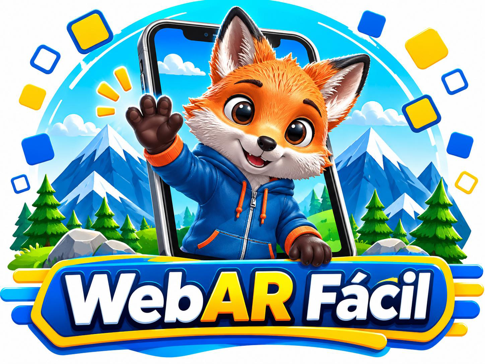

# WebAR Fácil



**[Official website](https://realidad-aumentada.com.co/webar-facil.html)** · **[Gallery of 35 examples](https://realidad-aumentada.com.co/webar-facil/ejemplos/)**

**[Español](README.md)** · **English** · [Manual](docs/en/README.md) · [Quick start](docs/en/getting-started.md)

An open-source TypeScript library for browser-based augmented reality. Build an experience around a JPG or PNG image, attach a GLB or MP4, and describe the scene in HTML. The standalone script includes the renderer, vision runtime, Workers, and model decoders.

```html
<script defer src="./webar-facil.min.js"></script>
<webar-scene>
  <webar-target src="./poster.jpg" target-id="poster">
    <webar-model src="./model.glb" size="0.3"></webar-model>
  </webar-target>
</webar-scene>
```

Copy the compiled script from `dist/` and serve your project over HTTP on localhost or HTTPS on a phone. See the [complete HTML example](docs/en/getting-started.md) and the [source code for all 35 examples](examples/PRUEBAS/).

The project also provides a JavaScript API, Three.js and A-Frame integrations, WebXR hit testing, and an optical tracking fallback. [Tracking modes and limits](docs/en/tracking.md)


## Autoría / Credits

**Creador / Creator:** IngCarlosReina. - Realidad Aumentada Empezando Desde Cero

- [Web](https://realidad-aumentada.com.co)
- [Blog](https://blog.realidad-aumentada.com.co)
- [YouTube](https://www.youtube.com/@carlosreinamcr)
