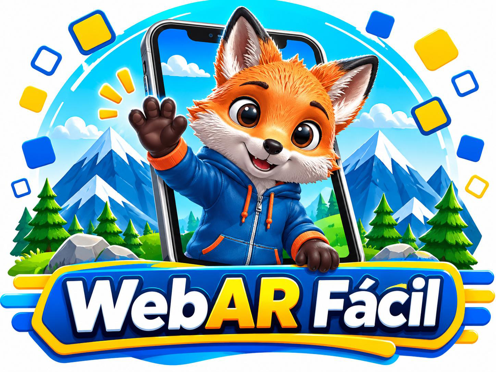

# WebAR Fácil



**[Sitio oficial](https://realidad-aumentada.com.co/webar-facil.html)** · **[Galería de 35 ejemplos](https://realidad-aumentada.com.co/webar-facil/ejemplos/)**

Biblioteca WebAR open-source en TypeScript: seguimiento de imágenes con webcam o cámara móvil, compilación automática JPG/PNG, contenido GLB y MP4, wrappers Three.js y A-Frame, WebXR y odometría WASM como fallback. No requiere un SDK cerrado ni suscripciones.

**Español** · **[English](README.en.md)** · [Manual](docs/README.md) · [Guía de inicio](docs/getting-started.md) · [API pública](docs/api-generated.md) · [Guía para IA](docs/ai-guide.md)

## Probar

Node.js >=22.18:

```sh
npm ci
npm run dev
```

Abre `http://127.0.0.1:5173/docs/` para leer la documentación con buscador, o `http://127.0.0.1:5173/examples/declarative.html` para probar una aplicación sin JavaScript propio. Pulsa Iniciar y muestra `http://127.0.0.1:5173/examples/assets/marcador.jpg` a la cámara.

No abras el HTML con `file://`. Para cámara desde un teléfono necesitas HTTPS accesible y confiable para ese dispositivo. El tracking de imágenes funciona sin WebXR y sin calibración manual.

**[Código de los 35 ejemplos](examples/PRUEBAS/)**. Incluye GLB, gestos, cambios de modelo, MP4, iluminación, mapas locales y el ejemplo métrico experimental.

Para probar los tres recorridos de la alfa, abre la [galería inicial](examples/alpha.html). Consulta la [guía de preparación de la alfa](docs/alpha-release.md).

## Crear tu propia aplicación

Para tu sitio, copia `webar-facil.min.js` desde `dist/` y crea tu `index.html`. El script publica `WebARFacil` e incluye Three.js, OpenCV/WASM, Workers, Draco y Meshopt. Añade tu marcador y tu modelo.

```html
<script defer src="./webar-facil.min.js"></script>
<webar-scene>
  <p>Cargando WebAR… Si este mensaje permanece, revisa la ruta y la versión del script.</p>
  <webar-target src="./imagen.jpg" target-id="poster">
    <webar-model src="./modelo.glb" size="0.3" rotation="0 180 0"></webar-model>
  </webar-target>
</webar-scene>
```

La biblioteca crea cámara, controles, escena y mensajes. La imagen genera descriptores internamente: no necesitas suministrar `.dat` o JSON. [HTML declarativo](docs/declarative.md) documenta atributos, animaciones, eventos, SLAM y carga remota. Para control explícito sigue disponible el [ejemplo programático](examples/documented-app.html).

El fragmento supone que el HTML está junto al bundle. [Inicio](docs/getting-started.md) incluye el HTML completo y las rutas para cada ubicación. Si tu aplicación usa una ruta de la distribución anterior, actualízala según la [tabla de instalación](docs/installation.md).

## Capacidades

- Hasta 8 imágenes diferentes con contenido y eventos por ID.
- Tolerancia de pérdida configurable, filtrado y retención visual opcional.
- Eventos `targetFound`, `targetLost`, `trackingQuality`, `targetVisibility`.
- GLB autocontenido normal, Draco y Meshopt; animación independiente del detector.
- MP4 y chroma declarativos con webar-video; reproducción nativa y transparencia en GPU.
- Gestos opt-in, pausa/velocidad/once/pingpong/crossfade y sustitución de contenido sin reiniciar cámara.
- WebXR hit-test y odometría con mapa local, exportación e importación con relocalización.
- ESM, IIFE, standalone y entrypoint core sin renderer.

El fallback puede derivar y no ofrece cierre de bucle global ni fusión IMU. La retención visual no equivale a un anclaje espacial. No se garantizan 60 FPS de análisis ni tracking perfecto en cualquier dispositivo. Consulta [evidencia y límites](docs/verification.md) y [validación física](docs/device-validation.md).

## Documentación para personas e IAs

- [Manual](docs/README.md): instalación, API, cámara, marcadores, medios, integraciones, SLAM, mapas, despliegue y errores.
- [Recetas declarativas](docs/recipes.md): controles de tamaño/giro, animaciones y cambios de contenido.
- [Interacción](docs/interaction.md): vídeo/chroma, gestos y cargas en vivo.
- [Validación de odometría](docs/odometry-validation.md): relocalización y comparación de deriva, con límites y opción experimental.
- [Diagnóstico iPhone/Android](docs/diagnostics.md): protocolo compartido, exportación local y comparación de informes; hardware físico pendiente de medir.
- [Colocación guiada](docs/placement.md): indicador válido, confirmación óptica y pérdida de seguimiento.
- [Distribución local](docs/local-release.md): versión, build e integridad; alojamiento público pospuesto.
- [Integración programática avanzada](docs/programmatic.md): alternativa para renderer propio y capacidades que requieren código.
- [llms.txt](llms.txt): índice de lectura para agentes.
- [llms-full.txt](llms-full.txt): manual consolidado con ejemplo y firmas.
- [docs/api.json](docs/api.json): exports y declaraciones generados desde el contrato real.
- `npm run docs:build` regenera el manual; `npm run docs:check` comprueba sus enlaces y contrato.

`npm run build` también genera la documentación navegable en `dist/docs/`, lista para publicar. El paquete local no implica publicación en el registro NPM; [instalación](docs/installation.md) explica el tarball.

Licencia MIT para el código propio. Conserva [los avisos de terceros](THIRD_PARTY_NOTICES.md) y las licencias de los recursos al redistribuir.


## Autoría / Credits

**Creador / Creator:** IngCarlosReina. - Realidad Aumentada Empezando Desde Cero

- [Web](https://realidad-aumentada.com.co)
- [Blog](https://blog.realidad-aumentada.com.co)
- [YouTube](https://www.youtube.com/@carlosreinamcr)
